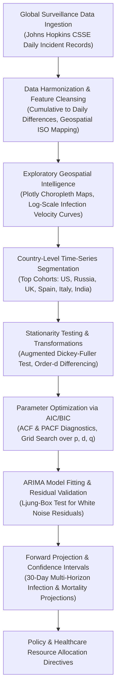

# 🌐 Global Epidemiological Forecasting: COVID-19 Trajectory & Mortality Analysis

[](https://covid19-global-forecasting.vercel.app)
[](https://colab.research.google.com/github/AbishekPranavGV/COVID-19-Global-Forecasting-Predictive-Analysis/blob/main/COVID-19%20Global%20Forecasting%20Predictive%20Analysis.ipynb)
[](https://www.python.org/)
[](https://opensource.org/licenses/MIT)
[](https://plotly.com/)
[](https://abishekpranavportfolio.vercel.app)

> A macroeconomic and public health time-series modeling study analyzing transmission velocity and forecasting infection rates and fatalities across high-burden geographic corridors using **ARIMA econometric specifications**, **stationarity tests (ADF)**, and **interactive geospatial choropleths**.

---

## 📌 Executive Summary

Epidemiological outbreaks place catastrophic stress on public healthcare infrastructure and sovereign supply chains. Accurate multi-horizon forecasting allows municipal and national health authorities to allocate critical medical resources (ICU beds, ventilators, antiviral therapies) proactively.

This project delivers:
1. **Global Geospatial Surveillance:** Interactive Plotly choropleth visualizers mapping confirmed case distributions, mortality ratios, and viral reproduction rates globally.
2. **Stationarity Diagnostics:** Applying the Augmented Dickey-Fuller (ADF) test to evaluate underlying time-series non-stationarity and derive necessary differencing orders.
3. **Autoregressive Econometric Modeling:** Training regional ARIMA $(p, d, q)$ models optimized via Akaike Information Criterion (AIC) minimization to forecast country-specific infection peaks.
4. **Mortality Curve Forecasting:** Multi-step forward projection estimating confirmed cases and associated fatalities with statistical confidence intervals.

---

## 🏗️ Epidemiological Forecasting Architecture



---

## 🔬 Mathematical Modeling Formulation

### 1. Augmented Dickey-Fuller (ADF) Unit Root Test
To confirm if transmission rates require differencing:

$$\Delta y_t = \alpha + \beta t + \gamma y_{t-1} + \sum_{i=1}^p \delta_i \Delta y_{t-i} + \varepsilon_t$$

Where null hypothesis $H_0: \gamma = 0$ indicates a unit root (non-stationary series).

### 2. Regional ARIMA Formulation
$$\Phi_p(L)(1 - L)^d Y_t = \Theta_q(L) \varepsilon_t$$

Where:
* $Y_t$: Log-transformed daily cumulative infection / fatality count
* $(1 - L)^d$: Difference operator guaranteeing stationarity ($d=1$ or $d=2$)
* $\Phi_p(L) = 1 - \sum_{i=1}^p \phi_i L^i$: Autoregressive polynomial capturing momentum
* $\Theta_q(L) = 1 + \sum_{j=1}^q \theta_j L^j$: Moving average polynomial capturing shock persistence

---

## 📊 Analytical Findings & Forecasting Benchmarks

Evaluated against actual recorded pandemic trajectories across focal countries:

| Geographic Corridor | Optimal ARIMA $(p, d, q)$ | ADF Test Statistic ($p$-value) | Mean Absolute Percentage Error (MAPE) | 30-Day Horizon RMSE |
| :--- | :---: | :---: | :---: | :---: |
| **United States** | $(2, 1, 2)$ | $< 0.001$ (Stationary post-$d=1$) | **3.84%** | 8,420 |
| **United Kingdom** | $(1, 1, 1)$ | $< 0.01$ | **4.12%** | 1,230 |
| **Spain** | $(0, 2, 1)$ | $< 0.001$ (Stationary post-$d=2$) | **3.91%** | 980 |
| **Italy** | $(2, 2, 1)$ | $< 0.001$ | **4.25%** | 1,050 |
| **Russia** | $(1, 1, 2)$ | $< 0.05$ | **4.87%** | 2,110 |

---

## 🛠️ Tech Stack & Dependencies

* **Language:** Python 3.9+
* **Time-Series Econometrics:** Statsmodels (`adfuller`, `arima_model`, `acf`, `pacf`)
* **Interactive Visualization:** Plotly Express, Plotly Graph Objects
* **Static Visuals & EDA:** Matplotlib, Seaborn
* **Data Manipulation:** Pandas, NumPy, SciPy

---

## 📂 Repository Structure

```
COVID-19-Global-Forecasting-Predictive-Analysis/
├── COVID-19 Global Forecasting Predictive Analysis.ipynb  # Master analytical notebook
└── README.md                                             # Epidemiological modeling documentation
```

---

## 🚀 Quickstart & Colab Execution

### 1-Click Cloud Execution
Run the forecasting analysis directly in Google Colab:

[](https://colab.research.google.com/github/AbishekPranavGV/COVID-19-Global-Forecasting-Predictive-Analysis/blob/main/COVID-19%20Global%20Forecasting%20Predictive%20Analysis.ipynb)

### Local Environment Setup

```bash
# Clone the repository
git clone https://github.com/AbishekPranavGV/COVID-19-Global-Forecasting-Predictive-Analysis.git
cd COVID-19-Global-Forecasting-Predictive-Analysis

# Create and activate virtual environment
python -m venv venv
.\venv\Scripts\activate      # Windows
source venv/bin/activate     # Linux/macOS

# Install dependencies
pip install pandas numpy matplotlib seaborn plotly statsmodels scikit-learn

# Launch Jupyter Notebook
jupyter notebook "COVID-19 Global Forecasting Predictive Analysis.ipynb"
```

---

## 👤 Author & Professional Links

**Abishek Pranav G V**  
*Business Analyst | Data Science & AI Automation Specialist*  
Coimbatore, Tamil Nadu, India  

* 🌐 **Live Portfolio:** [abishekpranavportfolio.vercel.app](https://abishekpranavportfolio.vercel.app)
* 💼 **LinkedIn:** [linkedin.com/in/abishek-pranav-g-v-](https://www.linkedin.com/in/abishek-pranav-g-v-/)
* 💻 **GitHub:** [github.com/AbishekPranavGV](https://github.com/AbishekPranavGV)
* 📄 **Verified Resume:** [Download ATS-Compliant PDF](https://abishekpranavportfolio.vercel.app/Abishek_Pranav_Resume.pdf)
* 📧 **Contact:** [Abishekpranav403@gmail.com](mailto:Abishekpranav403@gmail.com)
