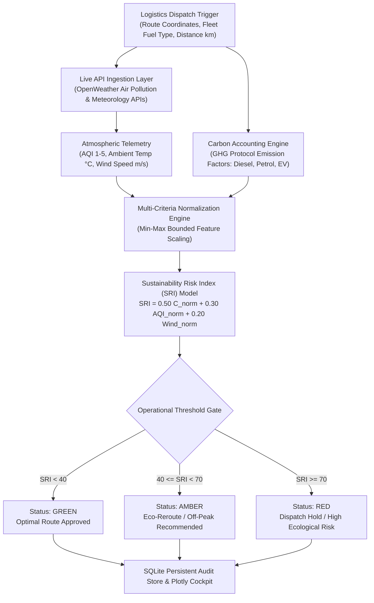

# 🌍 Intelligent Climate Impact & Logistics ESG Decision System

[](https://climate-impact-esg-dashboard.vercel.app)
[](https://colab.research.google.com/github/AbishekPranavGV/Climate-Impact-ESG-Dashboard/blob/main/real-time%20ESG%20monitoring%20system.ipynb)
[](https://www.python.org/)
[](https://opensource.org/licenses/MIT)
[](https://streamlit.io/)
[](https://abishekpranavportfolio.vercel.app)

> A real-time enterprise environmental governance cockpit that fuses **Scope 1/2 logistics emissions modeling** with **live ambient atmospheric telemetry** (OpenWeather Air Pollution & Meteorology APIs). Computes a multi-criteria **Sustainability Risk Index (SRI)** to drive automated green dispatch decisions.

---

## 📌 Executive Summary

Modern supply chains face strict corporate ESG compliance requirements (GHG Protocol, CSRD, SEBI BRSR). Logistics managers often lack real-time decision tools to balance dispatch velocity with carbon expenditure and environmental hazards.

This system provides:
1. **Dynamic Emissions Quantification:** Automated CO2e calculation across diverse fleet propulsion types (Diesel, Petrol, Electric).
2. **Real-Time Environmental Telemetry:** Continuous live ingestion of Air Quality Index (AQI: $PM_{2.5}, PM_{10}, CO, NO_2$) and meteorological wind vectors.
3. **Algorithmic Sustainability Risk Index (SRI):** A multi-factor normalized scoring engine that outputs actionable operational directives (`Proceed`, `Eco-Reroute`, or `Dispatch Hold`).
4. **Audit-Ready Transactional Logging:** Persistent SQLite database tracking historical carbon footprints, risk trajectories, and regulatory compliance logs.

---

## 🏗️ Architecture & Decision Engine Flow



---

## 🔬 Mathematical Formulation & Risk Weighting

### 1. Fleet Carbon Footprint Formulation
Emissions are quantified based on empirical combustion factors ($\text{kg } CO_2 / \text{unit}$):

$$E_{\text{carbon}} = D \times F_{\text{fuel}}$$

| Fleet Type | Emission Factor ($F_{\text{fuel}}$) | Unit Basis |
| :--- | :---: | :---: |
| **Heavy Diesel Fleet** | $2.68$ | $\text{kg } CO_2 / \text{km}$ |
| **Commercial Petrol / Light Goods** | $2.31$ | $\text{kg } CO_2 / \text{km}$ |
| **Battery Electric Vehicle (BEV)** | $0.50$ | $\text{kg } CO_2 \text{ equiv} / \text{km}$ (Grid average) |

### 2. Sustainability Risk Index (SRI)
$$\text{SRI} = 100 \times \left( w_c \cdot \min\left(\frac{E_{\text{carbon}}}{C_{\max}}, 1.0\right) + w_a \cdot \left(\frac{\text{AQI} - 1}{4}\right) + w_w \cdot \min\left(\frac{V_{\text{wind}}}{V_{\max}}, 1.0\right) \right)$$

* $w_c = 0.50$ (Carbon weight)
* $w_a = 0.30$ (Air pollution weight)
* $w_w = 0.20$ (Meteorological wind hazard weight)
* $C_{\max} = 2,000 \text{ kg}$, $V_{\max} = 20 \text{ m/s}$

---

## 📊 Operational Decision Matrix

| SRI Score Range | Classification | Fleet Impact | Operational Directive |
| :---: | :---: | :---: | :--- |
| **0 – 39** | 🟢 Low Risk | Minimal emissions, clean atmospheric corridor | Standard dispatch approved without restriction. |
| **40 – 69** | 🟡 Moderate Risk | Elevated AQI or long diesel haul | Advisory: Switch to EV fleet or shift dispatch window. |
| **70 – 100** | 🔴 Severe Risk | High particulate concentration / gale hazards | Mandatory Hold: Dispatch delay until corridor clears. |

---

## 🛠️ Tech Stack & Dependencies

* **Frontend Dashboard:** Streamlit, Streamlit Components
* **Real-Time Data Visualization:** Plotly Express, Plotly Graph Objects
* **Environmental Data Pipeline:** OpenWeatherMap Air Pollution & Weather REST APIs
* **Database & Persistence:** SQLite3 (Local zero-config transactional store)
* **Data Manipulation:** Pandas, NumPy, Requests

---

## 📂 Repository Structure

```
Climate-Impact-ESG-Dashboard/
├── app.py                                   # Streamlit interactive dashboard application
├── engine.py                                # Core SRI calculation and OpenWeather integration
├── database_utils.py.txt                    # Schema definitions and SQLite persistence helpers
├── real-time ESG monitoring system.ipynb    # Research & exploratory prototype notebook
├── requirements.txt                         # Python package dependencies
├── .env                                     # Environment variables (API credentials)
└── README.md                                # System documentation
```

---

## 🚀 Quickstart & Colab Execution

### 1-Click Cloud Execution
Run the exploratory prototype directly in Google Colab:

[](https://colab.research.google.com/github/AbishekPranavGV/Climate-Impact-ESG-Dashboard/blob/main/real-time%20ESG%20monitoring%20system.ipynb)

### Local Deployment

```bash
# Clone the repository
git clone https://github.com/AbishekPranavGV/Climate-Impact-ESG-Dashboard.git
cd Climate-Impact-ESG-Dashboard

# Create virtual environment
python -m venv venv
.\venv\Scripts\activate      # Windows
source venv/bin/activate     # Linux/macOS

# Install dependencies
pip install -r requirements.txt

# Configure your OpenWeather API key
echo "OPENWEATHER_API_KEY=your_key_here" > .env

# Launch the Streamlit dashboard
streamlit run app.py
```

---

## 👤 Author & Professional Links

**Abishek Pranav G V**  
*Business Analyst | Data Science & AI Automation Specialist*  
Coimbatore, Tamil Nadu, India  

* 🌐 **Live Portfolio:** [abishekpranavportfolio.vercel.app](https://abishekpranavportfolio.vercel.app)
* 💼 **LinkedIn:** [linkedin.com/in/abishek-pranav-g-v-](https://www.linkedin.com/in/abishek-pranav-g-v-/)
* 💻 **GitHub:** [github.com/AbishekPranavGV](https://github.com/AbishekPranavGV)
* 📄 **Verified Resume:** [Download ATS-Compliant PDF](https://abishekpranavportfolio.vercel.app/Abishek_Pranav_Resume.pdf)
* 📧 **Contact:** [Abishekpranav403@gmail.com](mailto:Abishekpranav403@gmail.com)
