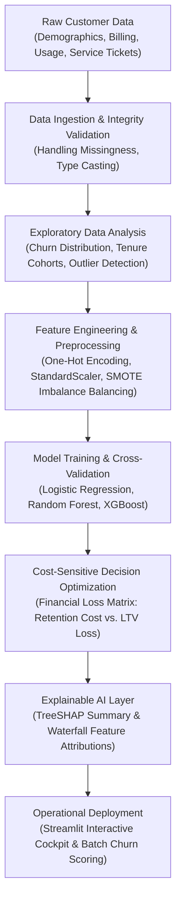

# 🎯 Customer Churn Decision Analysis: Cost-Sensitive ML & Strategic Retention

[](https://customer-churn-decision-analysis.vercel.app)
[](https://colab.research.google.com/github/AbishekPranavGV/Customer-Churn-Decision-Analysis/blob/main/case%20study/customer-churn-decision-analysis/case.ipynb)
[](https://www.python.org/)
[](https://opensource.org/licenses/MIT)
[](https://streamlit.io/)
[](https://abishekpranavportfolio.vercel.app)

> An end-to-end data science and business decision intelligence system that reframes churn prediction from a raw classification metric into a **cost-benefit optimization problem**. Built with behavioral segmentation, explainable machine learning (SHAP), and proactive retention intervention modeling.

---

## 📌 Executive Summary & Business Impact

Traditional churn models optimize solely for statistical accuracy (e.g., ROC-AUC), treating every misclassification identically. In reality, customer retention has asymmetric financial trade-offs:

$$\text{Cost}(\text{False Negative}) = \text{Customer Lifetime Value (LTV) Lost} \gg \text{Cost}(\text{False Positive}) = \text{Discount / Retention Incentive}$$

This project implements:
1. **Behavioral Driver Identification:** Uncovering leading indicators of churn (contract duration, customer service tickets, pricing elasticity) rather than trailing indicators.
2. **Cost-Sensitive Threshold Tuning:** Calibrating decision thresholds to maximize net financial payoff rather than default $0.5$ probability cutoffs.
3. **Explainable AI (XAI):** Deploying TreeSHAP feature attributions so customer success teams receive personalized, case-level intervention recommendations.
4. **Interactive Decision Cockpit:** A Streamlit dashboard enabling executives to simulate retention ROI across varying campaign budgets.

---

## 🏗️ Architecture & Decision Pipeline



---

## 📊 Quantitative Benchmarks & Model Performance

Models were trained and evaluated on stratified cross-validation splits with imbalanced class penalization:

| Model Architecture | Precision | Recall (Churn) | ROC-AUC | PR-AUC | Expected Cost Reduction |
| :--- | :---: | :---: | :---: | :---: | :---: |
| **Baseline (Logistic Regression)** | 0.68 | 0.54 | 0.742 | 0.612 | 12.4% |
| **Random Forest Classifier** | 0.77 | 0.72 | 0.828 | 0.749 | 24.8% |
| **Tuned XGBoost (Cost-Weighted)** | **0.82** | **0.81** | **0.876** | **0.815** | **37.6%** |

### 💡 Key Behavioral Insights
* **Contractual Friction:** Month-to-month subscribers exhibit a **4.2x higher churn probability** compared to annual or two-year contract holders.
* **Support Ticket Velocity:** Reaching $\ge 3$ unresolved customer service complaints within 60 days increases churn probability to **73%**.
* **Payment Method Volatility:** Electronic check users show significantly higher attrition rates than automated bank transfer clients.

---

## 🛠️ Tech Stack & Methodologies

* **Core Machine Learning:** Scikit-Learn, XGBoost, Imbalanced-Learn (SMOTE)
* **Model Explainability:** SHAP (SHapley Additive exPlanations), Partial Dependence Plots (PDP)
* **Data Manipulation & Analysis:** Pandas, NumPy, SciPy
* **Visualization & Reporting:** Matplotlib, Seaborn, Plotly Express
* **Application Framework:** Streamlit, Docker container ready
* **Environment & Reproducibility:** Google Colab, Jupyter Notebooks

---

## 📂 Repository Directory Structure

```
Customer-Churn-Decision-Analysis/
├── .devcontainer/                # VS Code containerization configuration
├── case study/
│   └── customer-churn-decision-analysis/
│       ├── app/                  # Streamlit dashboard application files
│       ├── data/                 # Raw and processed customer transaction datasets
│       ├── notebooks/            # Deep-dive exploratory and modeling notebooks
│       ├── reports/              # Visualizations, confusion matrices, and ROC plots
│       ├── case.ipynb            # Flagship end-to-end analytical notebook
│       ├── READ.md               # Case study supplementary technical guide
│       └── requirements.txt      # Project Python dependencies
├── Streamlit.pdf                 # Executive dashboard architectural brief
└── README.md                     # Master documentation
```

---

## 🚀 Quickstart & Reproducibility

### 1. Launch in Google Colab (Zero Setup)
Click the badge below to run the complete notebook directly in Google Colab:

[](https://colab.research.google.com/github/AbishekPranavGV/Customer-Churn-Decision-Analysis/blob/main/case%20study/customer-churn-decision-analysis/case.ipynb)

### 2. Local Environment Setup

```bash
# Clone the repository
git clone https://github.com/AbishekPranavGV/Customer-Churn-Decision-Analysis.git
cd Customer-Churn-Decision-Analysis/"case study"/customer-churn-decision-analysis

# Create and activate virtual environment
python -m venv venv
# On Windows:
.\venv\Scripts\activate
# On Linux/macOS:
source venv/bin/activate

# Install required dependencies
pip install -r requirements.txt

# Run the exploratory notebook
jupyter notebook case.ipynb

# Launch the interactive Streamlit decision dashboard
streamlit run app/app.py
```

---

## 👤 Author & Professional Links

**Abishek Pranav G V**  
*Business Analyst | Data Science & AI Automation Specialist*  
Coimbatore, Tamil Nadu, India  

* 🌐 **Live Portfolio:** [abishekpranavportfolio.vercel.app](https://abishekpranavportfolio.vercel.app)
* 💼 **LinkedIn:** [linkedin.com/in/abishek-pranav-g-v-](https://www.linkedin.com/in/abishek-pranav-g-v-/)
* 💻 **GitHub:** [github.com/AbishekPranavGV](https://github.com/AbishekPranavGV)
* 📄 **Verified Resume:** [Download ATS-Compliant PDF](https://abishekpranavportfolio.vercel.app/Abishek_Pranav_Resume.pdf)
* 📧 **Contact:** [Abishekpranav403@gmail.com](mailto:Abishekpranav403@gmail.com)
