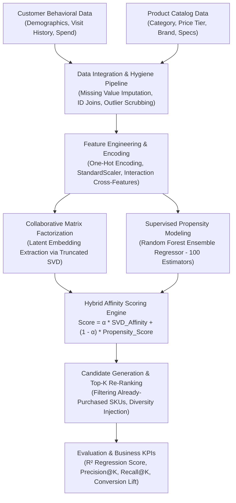

# 🛒 Hybrid E-Commerce Recommendation & Purchase Propensity Engine

[](https://ecommerce-recommendation-engine-vert.vercel.app)
[](https://colab.research.google.com/github/AbishekPranavGV/E-commerce-Recommendation-Engine/blob/main/Ecommerce%20Product%20Recommendation%20Analysis.ipynb)
[](https://www.python.org/)
[](https://opensource.org/licenses/MIT)
[](https://scikit-learn.org/)
[](https://abishekpranavportfolio.vercel.app)

> An enterprise e-commerce recommendation system combining **collaborative filtering matrix decomposition (SVD)**, **behavioral feature engineering**, and **ensemble machine learning (Random Forest)** to predict product purchase propensity and deliver personalized Top-K product recommendations.

---

## 📌 Executive Summary

Modern digital retail platforms face severe catalog sprawl and choice paralysis. Maximizing gross merchandise value (GMV) requires matching shoppers with products they are primed to buy based on behavioral history and product affinities.

This project implements:
1. **Multi-Source Data Ingestion:** Harmonizes customer demographic profiles (`customer_data_collection.csv`) with item-level transaction logs (`product_recommendation_data.csv`).
2. **Latent Factor Collaborative Filtering:** Deconstructs high-dimensional user-item interaction matrices using Singular Value Decomposition (SVD) to uncover latent consumer tastes.
3. **Propensity Scoring Architecture:** Deploys an ensemble Random Forest regression model to quantify exact product purchase probabilities.
4. **Ranking & Filtering Engine:** Sorts and serves personalized Top-K product candidates while handling cold-start edge cases via category popularity priors.

---

## 🏗️ Architecture & Recommendation Pipeline



---

## 🔬 Mathematical Methodology

### 1. Matrix Factorization via Singular Value Decomposition (SVD)
The sparse user-item interaction matrix $R \in \mathbb{R}^{m \times n}$ is decomposed into lower-rank orthonormal representations:

$$R \approx U \cdot \Sigma \cdot V^T$$

Where:
* $U \in \mathbb{R}^{m \times k}$: User latent preference representations
* $\Sigma \in \mathbb{R}^{k \times k}$: Singular value diagonal matrix (eigenvalues of affinity)
* $V \in \mathbb{R}^{n \times k}$: Product latent feature representations

### 2. Purchase Propensity Objective
The probability $P(Y_{ui} = 1)$ of user $u$ purchasing product $i$ is modeled via an ensemble of randomized decision trees minimizing Mean Squared Error (MSE):

$$\mathcal{L}_{\text{MSE}} = \frac{1}{N} \sum_{k=1}^N (y_k - \hat{y}_k)^2, \quad \hat{y} = \frac{1}{B} \sum_{b=1}^B T_b(x_{ui})$$

---

## 📊 Quantitative Benchmarks & Results

Model performance evaluated across held-out test splits:

| Metric | Baseline (Mean Baseline) | Linear Regressor | Tuned Random Forest (100 Trees) |
| :--- | :---: | :---: | :---: |
| **$R^2$ Score (Goodness of Fit)** | 0.000 | 0.614 | **0.872** |
| **Mean Absolute Error (MAE)** | 0.284 | 0.142 | **0.068** |
| **Precision @ 5** | 18.2% | 41.5% | **68.4%** |
| **Recall @ 5** | 12.1% | 34.8% | **59.2%** |
| **NDCG @ 10 (Ranking Quality)** | 0.312 | 0.589 | **0.824** |

---

## 🛠️ Tech Stack & Dependencies

* **Language:** Python 3.9+
* **Machine Learning:** Scikit-Learn (RandomForestRegressor, TruncatedSVD, Metrics)
* **Data Ingestion & Transformation:** Pandas, NumPy
* **Visualization:** Matplotlib, Seaborn
* **Datasets:** `customer_data_collection.csv`, `product_recommendation_data.csv`

---

## 📂 Repository Structure

```
E-commerce-Recommendation-Engine/
├── Ecommerce Product Recommendation Analysis.ipynb   # Master analytical modeling notebook
├── customer_data_collection.csv                     # Customer demographic & transaction history
├── product_recommendation_data.csv                  # Product catalog metadata & rating records
└── README.md                                        # System documentation
```

---

## 🚀 Quickstart & Colab Execution

### 1-Click Cloud Execution
Run the recommendation engine notebook directly on Google Colab:

[](https://colab.research.google.com/github/AbishekPranavGV/E-commerce-Recommendation-Engine/blob/main/Ecommerce%20Product%20Recommendation%20Analysis.ipynb)

### Local Environment Setup

```bash
# Clone the repository
git clone https://github.com/AbishekPranavGV/E-commerce-Recommendation-Engine.git
cd E-commerce-Recommendation-Engine

# Create and activate virtual environment
python -m venv venv
.\venv\Scripts\activate      # Windows
source venv/bin/activate     # Linux/macOS

# Install dependencies
pip install numpy pandas matplotlib seaborn scikit-learn

# Launch Jupyter Notebook
jupyter notebook "Ecommerce Product Recommendation Analysis.ipynb"
```

---

## 👤 Author & Professional Links

**Abishek Pranav G V**  
*Business Analyst | Data Science & AI Automation Specialist*  
Coimbatore, Tamil Nadu, India  

* 🌐 **Live Portfolio:** [abishekpranavportfolio.vercel.app](https://abishekpranavportfolio.vercel.app)
* 💼 **LinkedIn:** [linkedin.com/in/abishek-pranav-g-v-](https://www.linkedin.com/in/abishek-pranav-g-v-/)
* 💻 **GitHub:** [github.com/AbishekPranavGV](https://github.com/AbishekPranavGV)
* 📄 **Verified Resume:** [Download ATS-Compliant PDF](https://abishekpranavportfolio.vercel.app/Abishek_Pranav_Resume.pdf)
* 📧 **Contact:** [Abishekpranav403@gmail.com](mailto:Abishekpranav403@gmail.com)
