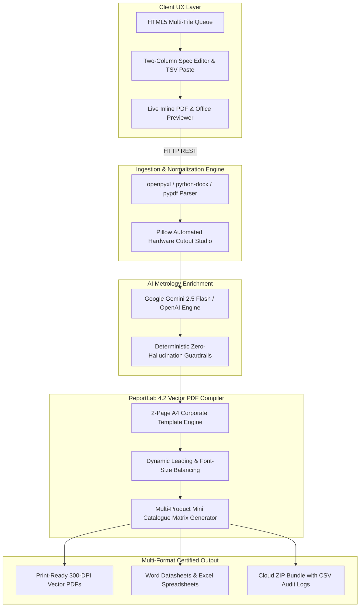

# NUNES Catalogue Studio 📐✨

[](https://nunes-catalogue-studio-live.vercel.app/)
[](https://www.python.org/)
[](https://flask.palletsprojects.com/)
[](https://www.reportlab.com/)
[](https://aistudio.google.com/)

> **Enterprise Metrology Catalogue Publishing Engine & Intelligent Document Ingestion Platform.**
> Automatically extracts specifications from spreadsheets, technical datasheets, Word docs, and scanned PDFs, enriches content via Google Gemini AI, and renders certified, publication-grade 2-page A4 catalogues and multi-product mini catalogues.

---

## 🌐 Live Application

Explore the live production deployment running on Vercel:
**[https://nunes-catalogue-studio-live.vercel.app/](https://nunes-catalogue-studio-live.vercel.app/)**

---

## 🎯 Highlights & Core Capabilities

### 1. 📂 Universal Multi-Format Document Ingestion Engine
- **Excel (`.xlsx`, `.xls`)**: Parses multi-sheet workbooks, detects arbitrary `Parameter : Value` tables, strips binary XML internals, and handles merged cells without text corruption.
- **Word (`.docx`)**: Extracts structured tables, bullet points, technical descriptions, and model numbers.
- **PDF Datasheets**: Dual-layer text extraction with OCR fallback for scanned spec sheets.
- **Images (`.png`, `.jpg`, `.webp`)**: Automated studio background removal isolating product hardware on clean white backdrops.
- **CSV / TXT / JSON**: Safe delimiter detection and schema-free specification parsing.

### 2. 🖨️ Precision Two-Page Metrology PDF Engine
- **Strict 2-Page A4 Reference Compliance**: Implements the official NUNES corporate design hierarchy (Magenta `#AC145A`, Slate `#536172`, Dark Navy `#1C2430`).
- **Dynamic Overflow Balancing**: Auto-regulates font size, leading, and paragraph spacing for 150–200 word descriptions so catalogues never overflow onto Page 3.
- **Multi-Product Mini Catalogues**: Automatically groups related instruments with buyer-intent keyword matrices.

### 3. 🤖 AI Metrology Enrichment (Google Gemini 2.5 Flash)
- **Controlled Generation**: Generates 150–200 word metrological descriptions focusing on operating principles, sensor mechanics, and calibration standards.
- **Zero Hallucination Rule**: Strictly preserves confirmed numbers, voltages, and measurement ranges; unverified numbers are never fabricated.
- **Rule-Based Verified Fallback**: Offline fallback engine operates seamlessly when API keys are absent.

### 4. ⚡ Bulk Product List Automation & Cloud Packaging
- **One-Click Batch Bundling**: Processes lists of products or source evidence, generates individual Full PDFs, compiles the combined Mini PDF, and packages everything into a downloadable ZIP with `BATCH_REPORT.csv`.
- **In-Browser Multi-File Queue**: Drag and drop multiple documents simultaneously with per-file progress tracking.

---

## 🏗️ Architecture & Technology Stack



```
                              ┌──────────────────────────────────────────────┐
                              │        Modern Web UX (HTML5 / Vanilla JS)    │
                              │  - Drag & Drop Multi-File Upload Queue       │
                              │  - Two-Column Spec Editor & TSV / Pipe Paste │
                              │  - Live Inline PDF Previewer & Word/Excel    │
                              └──────────────────────┬───────────────────────┘
                                                     │ HTTP JSON / REST
                                                     ▼
┌────────────────────────────────────────────────────────────────────────────────────────────────────┐
│                                   Flask Serverless Runtime (Vercel)                                │
│                                                                                                    │
│  ┌───────────────────────┐   ┌───────────────────────┐   ┌──────────────────────────────────────┐  │
│  │ Ingestion Pipeline    │   │ AI Content Service    │   │ ReportLab Rendering Engine           │  │
│  │ - openpyxl (Excel)    │   │ - Gemini 2.5 Flash    │   │ - template_layout.py (2-page A4)     │  │
│  │ - python-docx (Word)  │   │ - OpenAI gpt-4o-mini  │   │ - generator.py (Mini PDF matrix)     │  │
│  │ - pypdf / Pillow      │   │ - Rule-based Metrology│   │ - Pillow Cutout Studio               │  │
│  └───────────────────────┘   └───────────────────────┘   └──────────────────────────────────────┘  │
└────────────────────────────────────────────────────┬───────────────────────────────────────────────┘
                                                     │
                                                     ▼
                              ┌──────────────────────────────────────────────┐
                              │                 Output Formats               │
                              │  - Certified 2-Page Full PDF (Print Ready)   │
                              │  - Multi-Product Mini Catalogue PDF          │
                              │  - Editable Word Datasheet (.docx)           │
                              │  - Structured Spec Spreadsheet (.xlsx)       │
                              │  - Cloud ZIP Bundle with CSV Audit Report    │
                              └──────────────────────────────────────────────┘
```

---

## 📡 REST API Reference

| Endpoint | Method | Description |
|---|---|---|
| `/` | `GET` | Interactive Catalogue Studio Web Application |
| `/api/health` | `GET` | Health status and connected AI engine verification |
| `/api/config` | `GET` | Server mode and configuration capabilities |
| `/api/catalogue/upload-auto-generate` | `POST` | Upload file (`.xlsx`, `.docx`, `.pdf`, `.png`), extract specs, and return PDFs |
| `/api/preview` | `POST` | Render and stream real-time inline 2-page PDF |
| `/api/export/docx` | `POST` | Export formatted Microsoft Word `.docx` datasheet |
| `/api/export/excel` | `POST` | Export structured Microsoft Excel `.xlsx` specification table |
| `/api/product/research` | `POST` | Search product images and technical evidence from public sources |
| `/api/catalogue/enrich` | `POST` | Generate 150–200 word description + 8–10 key feature bullets |
| `/api/ai/draft` | `POST` | AI-assisted product drafting from unstructured raw text |
| `/api/catalogue/batch/prepare` | `POST` | Prepare and research single items for batch catalogue automation |
| `/api/catalogue/full-batch` | `POST` | Build downloadable ZIP of multiple Full PDFs + `BATCH_REPORT.csv` |
| `/api/catalogue/instant-cloud` | `POST` | Bundle Full PDFs, Mini PDF, and verification audit report into a ZIP |
| `/api/remove-background` | `POST` | Studio cutout background removal for product hardware images |

---

## 🚀 Quickstart & Local Installation

### Prerequisites
- Python 3.10+ (Recommended: Python 3.12)
- Git

### 1. Clone the Repository
```bash
git clone https://github.com/your-username/nunes-catalogue-studio.git
cd nunes-catalogue-studio
```

### 2. Set Up Virtual Environment
```bash
python -m venv .venv

# Windows
.venv\Scripts\activate

# macOS / Linux
source .venv/bin/activate
```

### 3. Install Dependencies
```bash
pip install -r requirements.txt
```

### 4. Configure Environment Variables
Copy the example environment configuration:
```bash
cp .env.example .env
```
Edit `.env` and set your Google Gemini API key:
```env
GEMINI_API_KEY=your_gemini_api_key_here
```

### 5. Run the Local Development Server
```bash
python webapp.py
```
Open your browser at **`http://127.0.0.1:5000`**.

---

## 🧪 Automated Testing & Verification

Run the full local test suite (tests file extractors, PDF layouts, and API routes):
```bash
python test_suite.py
python test_workflow_endpoints.py
```

Run live production end-to-end verification against the deployed domain:
```bash
python test_live_production.py
```

---

## ☁️ Deployment to Vercel

This repository is optimized for one-click serverless deployment on Vercel:

```bash
# Install Vercel CLI
npm install -g vercel

# Deploy directly
vercel deploy --prod
```

Configure your environment variables in the Vercel Dashboard under **Project Settings > Environment Variables**:
- `GEMINI_API_KEY`: Your Google Gemini API Key
- `NUNES_ADMIN_PASSWORD`: Secret admin key for protected exports

---

## 📄 License & Attribution

Developed for **NUNES Instrumentation / VTech Metrology**.  
Distributed under the **MIT License**. See `LICENSE` for details.
