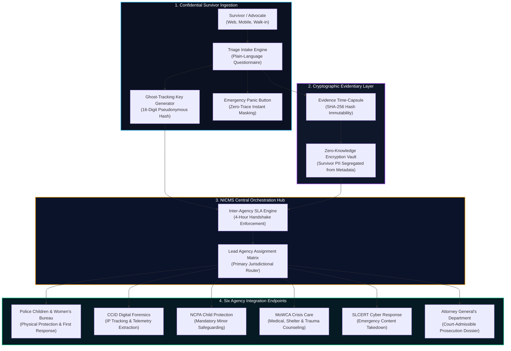

# NICMS: National Integrated Case Management System (Sri Lanka) 🏛️

> **Strategic Enterprise Systems Architecture & Digital Workflow Blueprint**  
> Unified Inter-Agency Governance Framework for SGBV & TFGBV Justice Delivery in Sri Lanka.

[](https://abishekpranavgv.github.io/NICMS-SriLanka-Strategic-Blueprint/)
[](./SRS.pdf)
[](https://abishekpranavportfolio.vercel.app)

[]()
[]()
[]()
[]()

---

## 🌐 Live Interactive Architecture Prototype

Experience the survivor intake journey, ghost-tracking security mechanism, and the real-time 4-hour inter-agency SLA handshake:  
👉 **[https://abishekpranavgv.github.io/NICMS-SriLanka-Strategic-Blueprint/](https://abishekpranavgv.github.io/NICMS-SriLanka-Strategic-Blueprint/)**

---

## 📌 Executive Summary & Problem Space

In Sri Lanka, survivors of Sexual and Gender-Based Violence (SGBV) and Technology-Facilitated Gender-Based Violence (TFGBV) endure what human rights observers term **"The Trauma of the Loop"**. 

Under current operational paradigms:
1. **Institutional Fragmentation**: Reporting a crime requires physically navigating across 6 independent ministries and state agencies.
2. **Repetitive Retraumatization**: Victims must narrate intimate, distressing evidence multiple times to separate jurisdictional officers.
3. **Evidence Degradation & Chain-of-Custody Loss**: Digital evidence (harassment metadata, unencrypted screenshots) lacks cryptographic stamping, leading to court inadmissibility.
4. **SLA Gaps & Case Stalling**: Referrals between police, child protection, and medical bureaus routinely stall due to lack of digital handover contracts.

### 🎯 The Strategic Objective
Unify the **six institutional pillars** into an authoritative, API-driven **"Single Window of Truth"** designed to enforce survivor dignity, immediate triage protection, and rigorous evidentiary integrity for the Attorney General’s Department.

---

## 🏗 End-to-End Inter-Agency System Architecture



---

## 🚀 Key Business Analysis & Systems Innovations

### 1. The 16-Digit "Ghost-Tracking" Justice Key
Survivors in shared or surveillance-prone domestic environments cannot safely store login credentials or receive SMS OTPs. NICMS generates a cryptographic 16-digit alphanumeric lookup key that permits read-only case status queries without revealing survivor identities, phone numbers, or residential addresses.

### 2. Evidence Time-Capsule (SHA-256 Court Admissibility)
Cyber harassment messages and digital blackmail artifacts are uploaded directly into an isolated evidence pipeline. Every file receives an immediate timestamped SHA-256 cryptographic digest matching legal standards for Section 65B electronic evidence admissibility.

### 3. The 4-Hour Inter-Agency Handshake SLA
Inter-agency referrals historically languished in manual paper trays. NICMS institutes an automated digital contract: when an intake touches digital blackmail, SLCERT and CCID receive an automated handover with an enforced 4-hour acknowledgment SLA. Unacknowledged handovers escalate automatically to executive ombudsmen.

### 4. Zero-Trace "Panic Exit"
A persistent, high-contrast Emergency Exit button immediately flushes local browser memory, destroys active sessions, and redirects the client viewport to an innocuous weather or educational portal.

---

## 📂 Repository Contents

```
NICMS-SriLanka-Strategic-Blueprint/
├── index.html                 # Interactive prototype & system architecture viewer
├── srs.js                     # Interactive intake logic, SLA counter & flow simulation
├── SRS.pdf                    # Complete 40+ page Software Requirements Specification
├── image.jpg                  # High-resolution architectural system map
└── README.md                  # Comprehensive executive systems documentation
```

---

## 👨‍💻 Author & Engineering Credits

**Abishek Pranav G V**  
*Business Analyst | Data & AI Automation | Process Improvement*  
- 🌐 **Portfolio**: [abishekpranavportfolio.vercel.app](https://abishekpranavportfolio.vercel.app)  
- 💼 **LinkedIn**: [linkedin.com/in/abishek-pranav-g-v-](https://www.linkedin.com/in/abishek-pranav-g-v-/)  
- 📄 **Resume**: [Download PDF](https://abishekpranavportfolio.vercel.app/Abishek_Pranav_Resume.pdf)  
- 📧 **Email**: [Abishekpranav403@gmail.com](mailto:Abishekpranav403@gmail.com)  
- 📱 **Phone**: +91 63835 00484  
- 📍 **Location**: Coimbatore, Tamil Nadu, India
