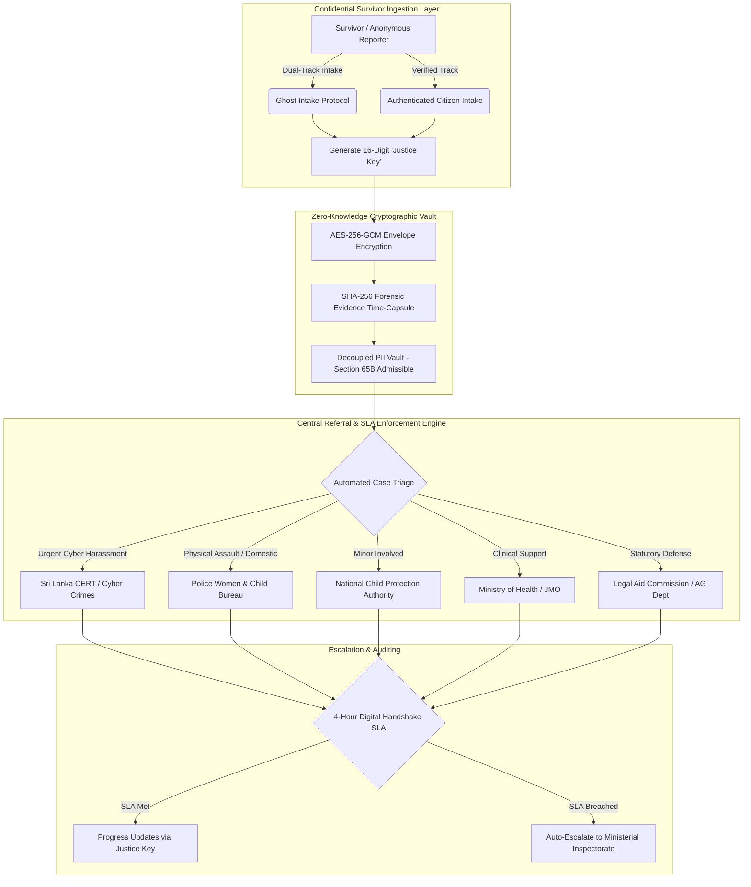

# NICMS: National Integrated Case Management System (Sri Lanka) 🛡️🇱🇰

[-6f42c1?style=for-the-badge)](https://www.scrum.org/)

> **Comprehensive Enterprise Systems Architecture, Technical Requirements Specification (SRS), and Interactive Prototype**  
> Formulated for the **National Integrated Case Management System (NICMS)** under the Ministry of Women and Child Affairs, Democratic Socialist Republic of Sri Lanka.  
> Eliminates *“The Trauma of the Loop”* by uniting 6 national ministries under an immutable, privacy-preserving digital referral backbone with enforced 4-hour SLA handshakes.

---

## 🌐 Live Interactive Architecture Prototype

Launch the fully responsive, zero-latency prototype simulating the complete survivor intake journey, ghost tracking, and ministry referrals:  
👉 **[https://abishekpranavgv.github.io/NICMS-SriLanka-Strategic-Blueprint/](https://abishekpranavgv.github.io/NICMS-SriLanka-Strategic-Blueprint/)**

---

## 📌 Executive Summary & The Problem

Survivors of Sexual and Gender-Based Violence (SGBV) and technology-facilitated abuse across Sri Lanka frequently endure **The Trauma of the Loop**:
- Forced to repeatedly recount traumatic experiences across uncoordinated agencies (Police WCD, NCPA, CERT|CC, Legal Aid, Health Services).
- Inconsistent paper records degrade chain-of-custody, jeopardizing Section 65B electronic evidence admissibility in the Attorney General's Department.
- Cross-agency referrals stall without statutory accountability or enforceable escalation triggers.

---

## 🏗️ Technical Architecture & Inter-Agency Handshake Protocol

---

## ⚡ Core Technical Pillars

1. **Anonymous 16-Digit “Justice Key”:**
   - Enables real-time case progression tracking from any device without storing cookies, phone numbers, or authentication tokens that could endanger survivors on monitored devices.
2. **Instant Zero-Trace Panic Exit:**
   - Client-side failsafe instantly purges session state, clears browser history, and redirects to a neutral government weather/educational portal upon a single click or double-Escape keypress.
3. **Forensic Evidence Time-Capsule (SHA-256 Chain of Custody):**
   - Automatically computes cryptographic hashes on digital evidence at the moment of intake, establishing non-repudiation for statutory court submission.
4. **Automated 4-Hour Handshake SLAs:**
   - Enforces digital inter-agency acknowledgments with auto-escalation to the National Steering Committee if a receiving ministry fails to action a critical referral within 240 minutes.

---

## 📂 Repository Contents

- [`index.html`](./index.html) — Interactive single-page architectural simulator and dynamic SRS explorer.
- [`srs.js`](./srs.js) — Complete structured requirement schema detailing all 10 modules, data dictionaries, and acceptance criteria.
- [`SRS.pdf`](./SRS.pdf) — Formal 40+ page enterprise Software Requirements Specification document.
- [`image.jpg`](./image.jpg) — High-definition system architecture schematic.

---

## 👤 Author & Systems Architect
**Abishek Pranav G V**  
AI Engineer & Intelligent Systems Architect  
- **Portfolio:** [abishekpranavportfolio.vercel.app](https://abishekpranavportfolio.vercel.app)  
- **GitHub:** [@AbishekPranavGV](https://github.com/AbishekPranavGV)  
- **LinkedIn:** [Abishek Pranav G V](https://www.linkedin.com/in/abishek-pranav-g-v-/)
