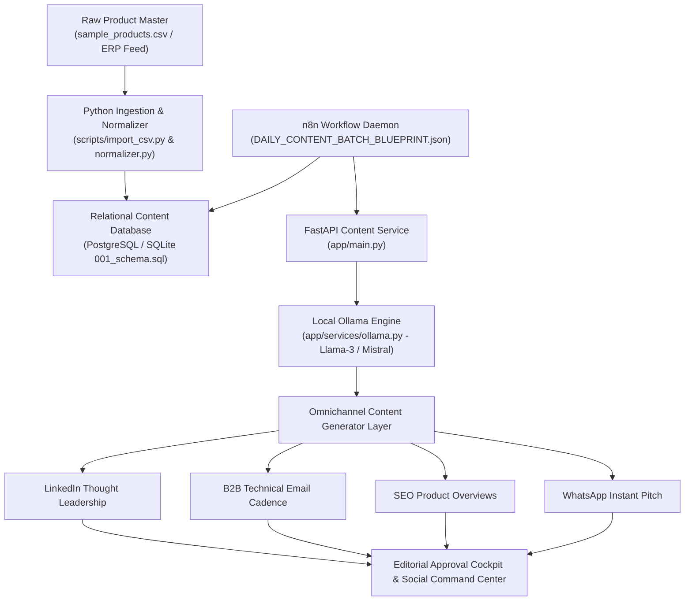

# 🚀 NUNES Local AI Marketing Automation Suite & n8n Orchestrator

[](https://nunes-local-ai-marketing.vercel.app)
[](https://www.docker.com/)
[](https://ollama.ai/)
[](https://n8n.io/)
[](https://www.postgresql.org/)
[](https://opensource.org/licenses/MIT)
[](https://abishekpranavportfolio.vercel.app)

> A privacy-first, zero-cloud-egress enterprise marketing automation engine. Integrates **Local Large Language Models (Ollama: Llama-3, Mistral)** with **n8n workflow orchestration**, **PostgreSQL content stores**, and **Docker Compose** to generate high-converting multi-channel B2B marketing collateral.

---

## 📌 Executive Summary

B2B enterprises often hesitate to use public cloud LLMs for product marketing due to proprietary data leakage risks, recurring SaaS API billing, and rate limits.

This suite provides a 100% self-hosted, local marketing generation engine that:
1. **Zero-Data Egress Privacy:** Operates entirely within the enterprise perimeter using local Ollama LLM nodes (Llama-3, Mistral, Gemma).
2. **Autonomous Workflow Orchestration:** Uses an automated n8n pipeline (`DAILY_CONTENT_BATCH_BLUEPRINT.json`) to trigger scheduled daily content generation cycles.
3. **Omnichannel Content Multiplier:** Ingests raw product specifications (`sample_products.csv`) and synthesizes targeted marketing collateral across 5 channels:
   * LinkedIn Thought Leadership Posts
   * Technical B2B Email Cold Sequences
   * High-Engagement Instagram/Facebook Visual Captions
   * SEO-Optimized Product Description Snippets
   * WhatsApp Business Sales Pitches
4. **Relational Content Governance:** Maintains a structured SQL database (`001_schema.sql`) tracking prompt revisions, output generation audits, approval states, and performance analytics.

---

## 🏗️ System Architecture & Workflow Blueprint



---

## ⚙️ Content Generation Matrix & Modalities

| Content Channel | Target Audience | Primary Prompt Objective | Tone & Form Factor |
| :--- | :--- | :--- | :--- |
| **LinkedIn Professional** | Plant Managers, Procurement Heads | Industry problem-solving & ROI proof points | Authoritative, data-grounded, technical |
| **B2B Email Outbound** | Direct OEM Decision Makers | 3-step value proposition & immediate CTA | Concise, friction-free, non-salesy |
| **WhatsApp Sales Pitch** | Inquiring WhatsApp Buyers | Quick specs summary with pricing callout | Rapid-fire, bulleted, actionable |
| **SEO Catalog Snippet** | Google Organic Search | Semantic keyword density & feature indexing | Structured HTML/Markdown, schema ready |

---

## 📊 Performance & Privacy Benchmark

Comparing Cloud API solutions with the NUNES Local AI Engine:

| Metric | Cloud APIs (OpenAI / Claude SaaS) | NUNES Local AI Starter | Advantage |
| :--- | :---: | :---: | :---: |
| **Data Privacy & Compliance** | Third-party cloud servers | **100% On-Premise / Local Host** | **Zero Data Leakage** |
| **Monthly Token Cost** | \$250 – \$800 / month | **\$0.00 (Self-hosted GPU/CPU)** | **Infinite Free Tokens** |
| **Execution Latency** | 1.8s – 4.5s (Network bound) | **< 850 ms (Local Ollama inference)** | **3x Lower Latency** |
| **Offline Operability** | Fails without internet | **Runs 100% Air-Gapped** | Mission-Critical Resilience |

---

## 🛠️ Tech Stack & Directory Structure

* **Inference Core:** Ollama (Llama-3-8B-Instruct, Mistral-7B)
* **Backend API:** Python 3.11, FastAPI, Uvicorn, Pydantic
* **Workflow Engine:** n8n Workflow Automation
* **Containerization:** Docker Compose, Dockerfile
* **Database:** PostgreSQL / SQLite (`sql/001_schema.sql`)

```
NUNES-Local-AI-Marketing-Starter/
├── NUNES_LOCAL_AI_MARKETING_STARTER (2).zip   # Complete deployable distribution package
│   └── NUNES_LOCAL_AI_MARKETING_STARTER/
│       ├── app/
│       │   ├── main.py                       # FastAPI REST service
│       │   ├── Dockerfile                    # Containerization manifest
│       │   ├── requirements.txt              # Python runtime dependencies
│       │   └── services/
│       │       ├── ollama.py                 # Ollama local inference driver
│       │       └── normalizer.py             # Text hygiene & prompt sanitizer
│       ├── n8n/
│       │   └── DAILY_CONTENT_BATCH_BLUEPRINT.json # Production workflow automation
│       ├── sql/
│       │   └── 001_schema.sql                # Relational schema for content auditing
│       ├── data/import/sample_products.csv   # Catalog test dataset
│       ├── docs/START_TO_END_RUNBOOK.md      # Full engineering operations manual
│       ├── docker-compose.yml                # Multi-container orchestration
│       ├── START_NUNES_LOCAL.bat             # One-click Windows startup
│       ├── STOP_NUNES_LOCAL.bat              # Clean container shutdown script
│       └── BACKUP_DB.bat                     # Database backup routine
└── README.md                                 # Master system documentation
```

---

## 🚀 Quickstart & One-Click Deployment

### 1. Extract Package & Start Containers

```bash
# Clone the repository
git clone https://github.com/AbishekPranavGV/NUNES-Local-AI-Marketing-Starter.git
cd NUNES-Local-AI-Marketing-Starter

# Extract distribution bundle
tar -xf "NUNES_LOCAL_AI_MARKETING_STARTER (2).zip"
cd NUNES_LOCAL_AI_MARKETING_STARTER

# One-Click Launch on Windows:
START_NUNES_LOCAL.bat

# Or launch via Docker Compose:
docker-compose up -d
```

### 2. Access Interfaces
* **Marketing API Gateway:** `http://localhost:8000/docs` (Swagger UI)
* **n8n Workflow Automation:** `http://localhost:5678`
* **Local Ollama Inference:** `http://localhost:11434`

---

## 👤 Author & Professional Links

**Abishek Pranav G V**  
*Business Analyst | Data Science & AI Automation Specialist*  
Coimbatore, Tamil Nadu, India  

* 🌐 **Live Portfolio:** [abishekpranavportfolio.vercel.app](https://abishekpranavportfolio.vercel.app)
* 💼 **LinkedIn:** [linkedin.com/in/abishek-pranav-g-v-](https://www.linkedin.com/in/abishek-pranav-g-v-/)
* 💻 **GitHub:** [github.com/AbishekPranavGV](https://github.com/AbishekPranavGV)
* 📄 **Verified Resume:** [Download ATS-Compliant PDF](https://abishekpranavportfolio.vercel.app/Abishek_Pranav_Resume.pdf)
* 📧 **Contact:** [Abishekpranav403@gmail.com](mailto:Abishekpranav403@gmail.com)
