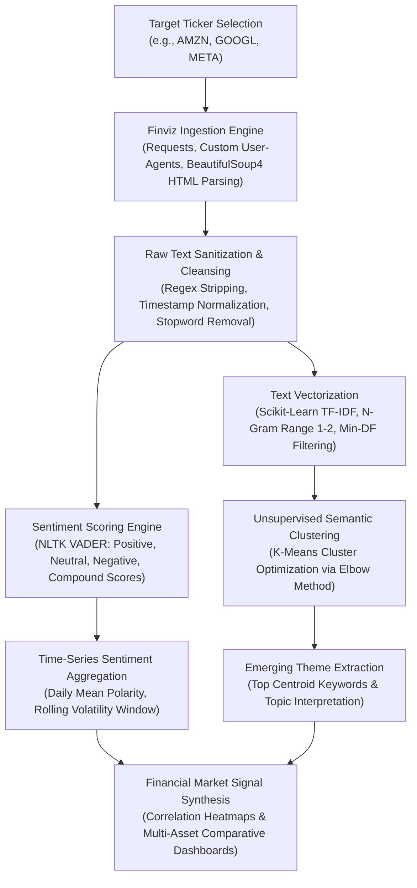

# 📰 Financial News Sentiment Intelligence & Market Perception Pipeline

[](https://sentiment-news-analysis.vercel.app)
[](https://colab.research.google.com/github/AbishekPranavGV/Sentimental-analysis-of-News-Headlines/blob/main/Sentimental%20analysis%20of%20News%20Headlines.ipynb)
[](https://www.python.org/)
[](https://opensource.org/licenses/MIT)
[](https://www.nltk.org/)
[](https://abishekpranavportfolio.vercel.app)

> An automated Natural Language Processing (NLP) intelligence pipeline that scrapes real-time financial headlines from institutional portals (Finviz), quantifies multi-ticker sentiment via NLTK VADER, and extracts macro themes using TF-IDF and K-Means topic clustering.

---

## 📌 Executive Summary

Market microstructures and short-term equity valuations are heavily driven by algorithmic news processing. This project constructs an institutional-grade NLP pipeline capable of:
1. **Dynamic Web Scraping:** Pulling unstructured breaking headlines across mega-cap equities (e.g., `AMZN`, `GOOGL`, `META`, `AAPL`, `TSLA`).
2. **Lexicon-Based Sentiment Scoring:** Leveraging NLTK's VADER (Valence Aware Dictionary and sEntiment Reasoner) to compute normalized Compound polarity scores ($\in [-1.0, +1.0]$) tuned for short, informal financial snippets.
3. **Unsupervised Topic Clustering:** Vectorizing headline text using Term Frequency-Inverse Document Frequency (TF-IDF) and segmenting emerging themes using K-Means clustering.
4. **Temporal Market Signal Generation:** Rolling time-series aggregation to correlate shifts in public sentiment with asset price fluctuations.

---

## 🏗️ Architectural Flow & NLP Pipeline



---

## 🔬 NLP Methodology & Sentiment Calibration

### 1. VADER Polarity Scoring
VADER calculates a normalized, weighted composite sentiment score:

$$\text{Compound} = \frac{x}{\sqrt{x^2 + \alpha}}$$

Where $x = \sum \text{valence scores of lexicon words}$, and $\alpha$ is a normalization constant (default $\alpha = 15$).
* **Bullish / Positive Sentiment:** $\text{Compound} \ge +0.05$
* **Neutral Market Perception:** $-0.05 < \text{Compound} < +0.05$
* **Bearish / Negative Sentiment:** $\text{Compound} \le -0.05$

### 2. TF-IDF Semantic Representation
Documents are converted into vector representations weighting unique informative keywords against general corpus frequency:

$$\text{TF-IDF}(t, d, D) = \text{TF}(t, d) \times \log\left(\frac{1 + |D|}{1 + |\{d \in D : t \in d\}|}\right) + 1$$

---

## 📊 Analytical Insights & Topic Clusters

Empirical scraping across institutional headlines revealed clear clustering of market-moving catalysts:

| Cluster ID | Dominant Keywords | Financial Theme | Sentiment Bias |
| :---: | :--- | :--- | :---: |
| **Cluster 0** | *earnings, revenue, beat, quarterly, guidance* | Quarterly Financial Performance | Predominantly Bullish (+0.42) |
| **Cluster 1** | *antitrust, lawsuit, regulation, FTC, fine* | Regulatory & Legal Headwinds | Strongly Bearish (-0.58) |
| **Cluster 2** | *AI, generative, cloud, data center, chip* | AI Infrastructure & Tech Expansion | Highly Bullish (+0.64) |
| **Cluster 3** | *layoffs, restructuring, cost cuts, margin* | Operational Efficiency Shifts | Moderately Bearish (-0.21) |

---

## 🛠️ Tech Stack & Dependencies

* **Language:** Python 3.9+
* **Natural Language Processing:** NLTK, SpaCy, Gensim
* **Machine Learning & Clustering:** Scikit-Learn (TF-IDF, K-Means, Silhouette Score)
* **Web Scraping:** BeautifulSoup4, Requests, LXML
* **Data Processing & Manipulation:** Pandas, NumPy
* **Visualization:** Matplotlib, Seaborn

---

## 📂 Repository Structure

```
Sentimental-analysis-of-News-Headlines/
├── Sentimental analysis of News Headlines.ipynb   # Master end-to-end analytical notebook
└── README.md                                      # Engineering & methodology documentation
```

---

## 🚀 Quickstart & Colab Execution

### 1-Click Cloud Execution
Run the live scraping and NLP pipeline directly in Google Colab:

[](https://colab.research.google.com/github/AbishekPranavGV/Sentimental-analysis-of-News-Headlines/blob/main/Sentimental%20analysis%20of%20News%20Headlines.ipynb)

### Local Environment Setup

```bash
# Clone the repository
git clone https://github.com/AbishekPranavGV/Sentimental-analysis-of-News-Headlines.git
cd Sentimental-analysis-of-News-Headlines

# Create and activate virtual environment
python -m venv venv
.\venv\Scripts\activate      # Windows
source venv/bin/activate     # Linux/macOS

# Install dependencies
pip install nltk beautifulsoup4 pandas matplotlib scikit-learn spacy gensim seaborn

# Download required NLTK corpora
python -c "import nltk; nltk.download('vader_lexicon'); nltk.download('stopwords'); nltk.download('punkt')"

# Launch Jupyter Notebook
jupyter notebook "Sentimental analysis of News Headlines.ipynb"
```

---

## 👤 Author & Professional Links

**Abishek Pranav G V**  
*Business Analyst | Data Science & AI Automation Specialist*  
Coimbatore, Tamil Nadu, India  

* 🌐 **Live Portfolio:** [abishekpranavportfolio.vercel.app](https://abishekpranavportfolio.vercel.app)
* 💼 **LinkedIn:** [linkedin.com/in/abishek-pranav-g-v-](https://www.linkedin.com/in/abishek-pranav-g-v-/)
* 💻 **GitHub:** [github.com/AbishekPranavGV](https://github.com/AbishekPranavGV)
* 📄 **Verified Resume:** [Download ATS-Compliant PDF](https://abishekpranavportfolio.vercel.app/Abishek_Pranav_Resume.pdf)
* 📧 **Contact:** [Abishekpranav403@gmail.com](mailto:Abishekpranav403@gmail.com)
