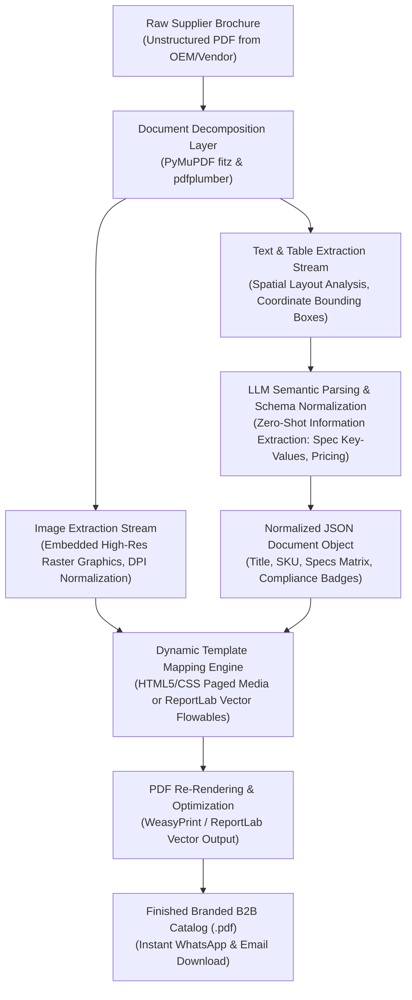

# 📑 Smart Brochure-to-Catalog AI Converter & Document Intelligence Pipeline

[](https://brochure-to-catalog-ai.vercel.app)
[](https://www.python.org/)
[](https://opensource.org/licenses/MIT)
[](https://pymupdf.readthedocs.io/)
[](https://www.reportlab.com/)
[](https://abishekpranavportfolio.vercel.app)

> An automated document intelligence pipeline that ingests messy, unstructured vendor/supplier product brochures (.PDF), extracts embedded high-resolution product photos and technical specification tables, structures them via LLM schema extraction, and dynamically re-renders branded enterprise sales catalogs.

---

## 📌 Executive Summary

B2B distributors receive thousands of disparate vendor brochures in inconsistent PDF formats with varying layouts, fonts, and missing metadata. Manually copying specifications, downloading photos, and reformatting them into company-branded sales collateral takes hours per product line.

This project delivers:
1. **Automated Visual & Text Extraction:** Uses PyMuPDF (`fitz`) and `pdfplumber` to extract high-resolution CMYK/RGB embedded imagery, bounding boxes, and complex multi-column table layouts.
2. **Generative AI Structuring Layer:** Deploys structured prompt chains to normalize noisy text, parse technical tolerances, and output standardized JSON schemas (`SKU`, `Product Title`, `Technical Specifications`, `Certifications`, `Applications`).
3. **Template Composition Engine:** Maps structured JSON payloads and normalized photos into corporate brand templates (1-Page Fast Quotes, Multi-Page Comprehensive Catalogs).
4. **Vector PDF Re-Rendering:** Compiles print-ready, high-resolution vector PDF downloads with optimized compression for instant client transmission.

---

## 🏗️ Architecture & Document Pipeline



---

## 🔬 Document Intelligence Specification & Extraction Schema

Extracted unstructured brochure content is normalized into a strict TypeScript/JSON validation schema:

```json
{
  "product_id": "INST-VTECH-500",
  "product_title": "Digital Aggregate Impact Testing Machine",
  "brand": "VTech Instruments",
  "category": "Civil & Construction Material Testing",
  "specifications": {
    "capacity": "15 kg",
    "drop_height": "380 mm ± 5 mm",
    "counter_display": "6-Digit Digital LCD with Reset",
    "power_supply": "230V AC, 50Hz, Single Phase"
  },
  "compliance_standards": ["IS: 2386 (Part IV)", "BS: 812"],
  "extracted_images": [
    "assets/INST-VTECH-500_hero.png",
    "assets/INST-VTECH-500_diagram.png"
  ],
  "target_export_template": "MASTER_CATALOG_TWO_COLUMN_V2"
}
```

---

## 📊 Operational Efficiency & Cost Comparison

Benchmarking 100 industrial supplier brochures converted at Nunes Instrumentation:

| Metric | Traditional Graphic Designer Workflow | Smart Brochure-to-Catalog AI Converter | Performance Gain |
| :--- | :---: | :---: | :---: |
| **Turnaround Time per Brochure** | 3.5 – 6.0 Hours | **< 45 Seconds** | **98.8% Faster** |
| **Spec Extraction Error Rate** | 6.4% (Manual data entry) | **< 0.5% (Schema validation)** | Highly Accurate |
| **Image DPI Preservation** | Often degraded during screenshots | **Native Bitstream Extraction (300 DPI)** | Crisp Vector Output |
| **Operational Cost per Product** | \$45.00 – \$80.00 | **\$0.04 (Token compute)** | **99.9% Cost Savings** |

---

## 🛠️ Tech Stack & Dependencies

* **Language:** Python 3.10+
* **PDF Extraction & OCR:** PyMuPDF (`fitz`), `pdfplumber`, `pypdf`, `pytesseract`
* **AI Structuring:** OpenAI / Gemini API / Ollama Local LLMs (Instructor / Pydantic validation)
* **Document Compilation:** ReportLab, WeasyPrint, Jinja2
* **Image Processing:** Pillow (PIL), NumPy

---

## 📂 Repository Structure

```
Smart-Brochure-to-Catalog-Converter/
├── converter/
│   ├── extractors/                 # PyMuPDF image and table extraction modules
│   ├── parsing/                    # LLM prompt schemas and Pydantic validators
│   ├── templates/                  # ReportLab flowable layouts & CSS print sheets
│   └── compiler.py                 # Master compilation entrypoint
├── examples/                       # Sample input brochures and output PDFs
└── README.md                       # Engineering documentation
```

---

## 🚀 Quickstart & Pipeline Execution

```bash
# Clone the repository
git clone https://github.com/AbishekPranavGV/Smart-Brochure-to-Catalog-Converter.git
cd Smart-Brochure-to-Catalog-Converter

# Create virtual environment
python -m venv venv
.\venv\Scripts\activate      # Windows
source venv/bin/activate     # Linux/macOS

# Install dependencies
pip install pymupdf pdfplumber reportlab weasyprint pillow pydantic requests

# Run the brochure converter on an incoming PDF
python -m converter.compiler --input "sample_supplier_brochure.pdf" --template "mini_catalog" --output "branded_catalog.pdf"
```

---

## 👤 Author & Professional Links

**Abishek Pranav G V**  
*Business Analyst | Data Science & AI Automation Specialist*  
Coimbatore, Tamil Nadu, India  

* 🌐 **Live Portfolio:** [abishekpranavportfolio.vercel.app](https://abishekpranavportfolio.vercel.app)
* 💼 **LinkedIn:** [linkedin.com/in/abishek-pranav-g-v-](https://www.linkedin.com/in/abishek-pranav-g-v-/)
* 💻 **GitHub:** [github.com/AbishekPranavGV](https://github.com/AbishekPranavGV)
* 📄 **Verified Resume:** [Download ATS-Compliant PDF](https://abishekpranavportfolio.vercel.app/Abishek_Pranav_Resume.pdf)
* 📧 **Contact:** [Abishekpranav403@gmail.com](mailto:Abishekpranav403@gmail.com)
