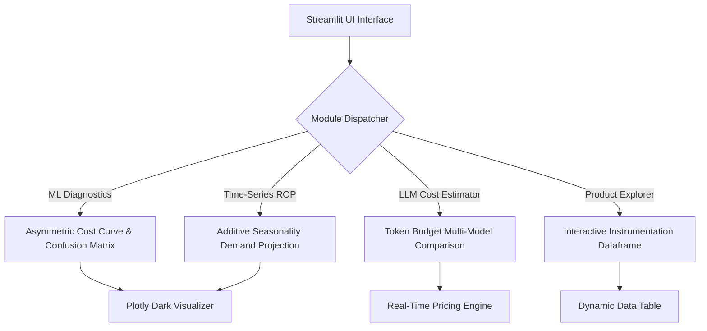

# Streamlit AI Analytics & Data Science Interactive Studio 📊⚡

[](https://github.com/AbishekPranavGV/Streamlit)
[](https://python.org)
[](https://plotly.com/)
[](LICENSE)

> **Interactive Data Science & Applied AI Decision Workbench.**  
> A high-performance Streamlit analytics application integrating asymmetric business loss modeling, econometric time-series demand forecasting (Prophet vs. ARIMA), multi-model LLM inference token estimation, and industrial instrumentation data exploration.

---

## 🎯 Studio Capabilities

1. **Machine Learning Diagnostics & Asymmetric Loss Curve:**
   - Evaluates classification thresholds ($\tau$) against real-world asymmetric business costs (where False Negatives carry a $5\times$ higher cost than False Positives).
2. **Time-Series Demand Forecasting & ROP Simulation:**
   - Visualizes historical POS sales data and projects 30-day ahead demand curves using additive seasonality decomposition.
3. **Enterprise LLM Token & Cost Estimator:**
   - Real-time pricing calculator comparing monthly token budgets across **Google Gemini 2.5 Flash**, **Claude 3.5 Sonnet**, and **GPT-4o**.
4. **Multimodal Instrumentation Explorer:**
   - Interactive database inspector for metrological sensor ranges, tolerances, and calibration standards.

---

## 🏗️ Architectural Flow



---

## 💻 Local Installation & Execution

```bash
# Clone the repository
git clone https://github.com/AbishekPranavGV/Streamlit.git
cd Streamlit

# Install required dependencies
pip install -r requirements.txt

# Run the interactive studio locally
streamlit run streamlit_app.py
```

---

## 👤 Author
**Abishek Pranav G V**  
AI Engineer & Intelligent Systems Specialist  
- **Portfolio:** [abishekpranavportfolio.vercel.app](https://abishekpranavportfolio.vercel.app)  
- **GitHub:** [@AbishekPranavGV](https://github.com/AbishekPranavGV)  
- **LinkedIn:** [Abishek Pranav G V](https://www.linkedin.com/in/abishek-pranav-g-v-/)
