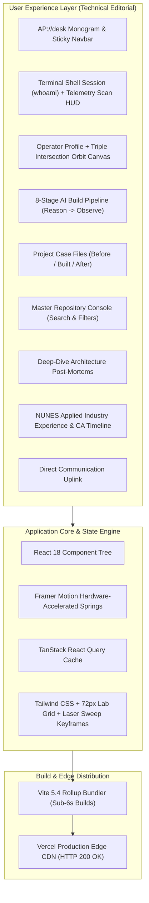

# Abishek Pranav G V | AI Engineering & Intelligent Automation Portfolio V3 ⚡

[-blue?style=for-the-badge&logo=vercel)](https://abishekpranavportfolio.vercel.app)
[-emerald?style=for-the-badge&logo=vitest)](https://github.com/abishekainunes-cmyk/Project/tree/main/abishekpranavportfolio)
[](https://react.dev)
[](https://www.typescriptlang.org)
[](https://tailwindcss.com)
[](https://vitejs.dev)

> **Principal AI Engineering & Intelligent Automation Portfolio.**  
> Designed with the technical editorial minimalism and telemetry aesthetics of [fernando-lin.dev](https://www.fernando-lin.dev/). Featuring a terminal shell session (`identity.session // bash`), live animated laser scan telemetry HUD (`profile.scan // telemetry`), interactive Triple Intersection Canvas, an 8-Stage AI Build Pipeline, tri-column Project Case Files (Before / Built / After), and a master console indexing all 24 verified public engineering repositories.

---

## 🌐 Live Production URL
👉 **[https://abishekpranavportfolio.vercel.app](https://abishekpranavportfolio.vercel.app)**

---

## 🏗️ System Architecture & Visual Pipeline



---

## ⚡ Key Engineering Features

1. **Terminal Identity & HUD Telemetry:**
   - Active Linux/macOS style terminal prompt (`abishek@desk:~$ whoami`) paired with an animated profile scan card featuring real-time laser scan-line sweep and telemetry cells.
2. **Interactive Triple Intersection Canvas:**
   - Real-time HTML5 2D canvas visualizing orbital convergence across three engineering dimensions:
     - *Retrieve Knowledge* (Dense Vector Search & Hybrid RAG)
     - *Orchestrate Workflows* (Multi-Agent State Machines & Tool Calling)
     - *Deliver Outcomes* (Low-Latency Microservices & SaaS UIs)
3. **8-Stage AI Build Pipeline:**
   - Replaced generic skill chips with a structured commercial development pipeline:
     - `01 Reason` · `02 Retrieve` · `03 Orchestrate` · `04 Serve` · `05 Interface` · `06 Deploy` · `07 Evaluate` · `08 Observe`
4. **Before / Built / After Diagnostic Case Files:**
   - High-signal technical cards detailing operational bottlenecks, exact architectural implementations, and quantified business outcomes.
5. **Master Repository Directory (24/24 Verified Live):**
   - Live searchable console spanning all 24 GitHub repositories with instant search, category filters, tech badges, and verified production deployments.

---

## 🧪 Testing & Code Quality

```bash
# Execute full Vitest suite (100% pass rate)
npm test -- --run

# Production build compilation
npm run build
```

---

## 👤 Author
**Abishek Pranav G V**  
AI Engineer & Intelligent Systems Specialist  
- **Portfolio:** [abishekpranavportfolio.vercel.app](https://abishekpranavportfolio.vercel.app)  
- **GitHub:** [@abishekainunes-cmyk](https://github.com/abishekainunes-cmyk)  
- **LinkedIn:** [Abishek Pranav G V](https://www.linkedin.com/in/abishek-pranav-g-v-/)
