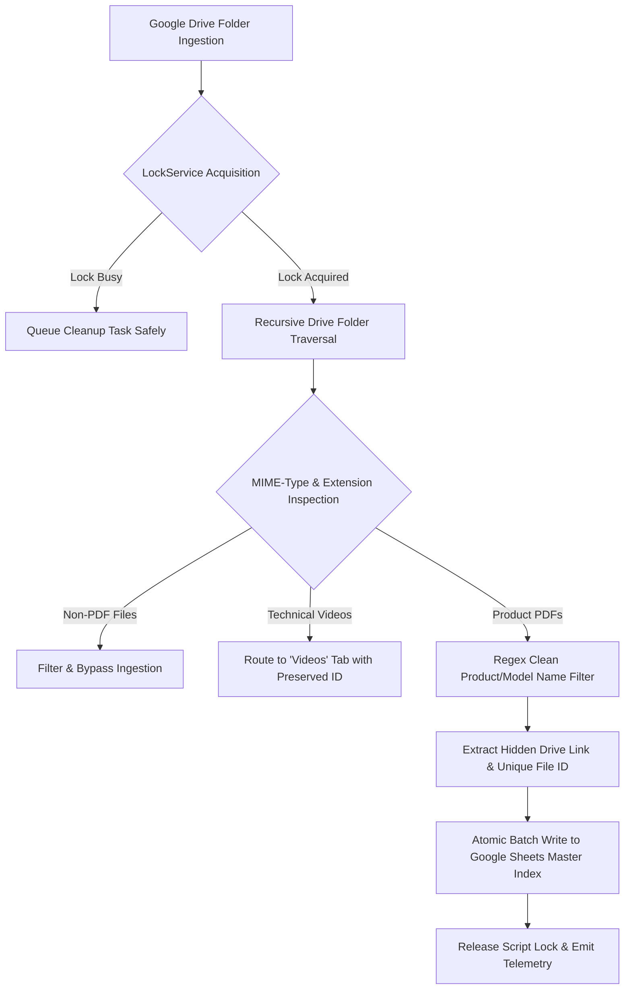

# NUNES Drive File Indexer & Metadata Engine (V3.7) 📁⚡

> **Enterprise Google Drive File Indexer & Metadata Normalization Engine.**
> High-throughput Google Apps Script daemon that orchestrates recursive enterprise Google Drive folder crawling, resolves concurrency race conditions via distributed script locks, filters technical instrumentation collateral, and synchronizes clean SKU models to Google Sheets master databases in real time.

---

## 🌐 Live Interactive Simulator

Experience the live architectural simulator demonstrating the V3.7 Lock Coordination and Name Normalization pipeline:  
👉 **[https://nunes-drive-file-indexer.vercel.app](https://nunes-drive-file-indexer.vercel.app)**

---

## 🎯 Problem Statement & Business Context

At **NUNES Instrumentation**, engineering documentation, supplier datasheets, and multi-product mini catalogues were scattered across dozens of nested Google Drive folders. Manual audit attempts resulted in:
- **Lock Contention:** Multi-user scans triggered Google Apps Script `Lock timeout` exceptions during large directory reconciliations.
- **Filename Noise:** Raw files contained internal date codes, vendor prefixes, and temporary revision tags (e.g., `NUNES_VT_2026_Digital_Multimeter_Final_v3.pdf`).
- **Data Pollution:** Non-technical documents (`.docx`, `.tmp`) mixed with production-ready customer brochures, breaking quotation generation workflows.

---

## 🏗️ System Architecture & Execution Flow

---

## ⚡ Core Engineering Capabilities (V3.7)

1. **Distributed Script Lock Coordination:**
   - Employs `LockService.getScriptLock()` with deterministic backoff. If a background scan is active, cleanup tasks are safely deferred without crashing or corrupting sheet pointers.
2. **Strict Immutability Guarantee:**
   - Raw Google Drive assets are **never** renamed, moved, or deleted on the cloud drive. Normalization is strictly applied at the presentation and master indexing tier.
3. **MIME-Enforced PDF Filtering:**
   - Guarantees that only valid, high-resolution specification PDFs populate the primary `Normal Files` index.
4. **Preserved File Lineage:**
   - Retains hidden unique Drive File IDs (`file.getId()`) and authenticated viewing URLs (`file.getUrl()`) across all database mutations.

---

## 🛠️ Deployment & Execution

### Deploy to Google Apps Script
1. Create a new Google Sheet and open **Extensions → Apps Script**.
2. Paste the contents of [`Code.gs`](./Code.gs).
3. Save the project and execute `APPLY_V3_7_SHEET_RULES_ONCE`.
4. Deploy as a Web App with domain-level execution permissions.

---

## 👤 Author
**Abishek Pranav G V**  
AI Engineer & Intelligent Automation Specialist  
- **Portfolio:** [abishekpranavportfolio.vercel.app](https://abishekpranavportfolio.vercel.app)  
- **GitHub:** [@AbishekPranavGV](https://github.com/AbishekPranavGV)  
- **LinkedIn:** [Abishek Pranav G V](https://www.linkedin.com/in/abishek-pranav-g-v-/)